<!-- Header -->

  

  

  
  
  

---

### About me

I'm an AI & Data Science undergraduate at Madras Institute of Technology, Anna University. I recently completed an AI/ML Engineer internship at Educately AI, a U.S.-based EdTech startup building a Socratic AI tutoring platform.

Captain Cool is my blueprint: patient in the build, decisive at the finish.

---

### By the numbers

  

---

### Featured projects

  
  
  
  

  More: <a href="https://github.com/BalaMSD7781/AI-Skin-Analyzer-and-Skincare-Recommender"><b>AI Skin Analyzer</b></a> (<a href="https://ai-skin-analyzer-and-skincare-recommender.streamlit.app/">live demo</a>) ·
  <a href="https://github.com/BalaMSD7781/Generative-Ai"><b>Generative AI Lab</b></a> ·
  <a href="https://github.com/BalaMSD7781/COMPUTER-VISION-LABORATORY"><b>Computer Vision Lab</b></a>

---

### Tech stack

  

  
  
  
  
  
  
  
  

<!-- Footer -->

  

